# AiD Communication App
By: Thomas Azevedo

RAG-powered Streamlit assistant that helps caregivers work with people with aphasia using only the provided documents.

## Application Identity
- **Name:** AiD Communication App
- **Purpose:** Support communication, cognitive recovery, and mobility practice for people with aphasia (and their caregivers track patients progress).
- **Knowledge base:** 8 PDFs covering caregiver communication strategies, AAC assessment and options, cognitive exercises, and full-body mobility exercises.

## Full Pipeline
1. **Document Loading** — PDFs in `documents/` are read with pypdf.
2. **Text Cleaning** — Removes excess whitespace, page numbers, and copyright lines.
3. **Chunking** — Fixed-size chunks (≈700 characters) with 100-character overlap to preserve context. Each chunk keeps source filename, page number, and unique chunk ID.
4. **Embeddings** — OpenAI `text-embedding-3-small` converts every chunk (and later every query) into vectors.
5. **Persistent Storage** — Chunks, embeddings, and metadata are stored once in ChromaDB (`./chroma_db`). The database is not rebuilt on subsequent runs.
6. **Query** — User question is embedded with the same model.
7. **Semantic Search** — Top-K (4) most similar chunks are retrieved by cosine distance.
8. **Relevance Filtering** — Chunks below the threshold are discarded.
9. **Grounded Generation** — Retrieved context + system prompt are sent to the LLM. The model is instructed to answer only from the context and to cite sources.
10. **Citations & Interface** — Answers include `[Source: filename, p. X]` citations. An expander shows the raw retrieved text, page, and score. Conversation history is kept in `st.session_state`.

## Secure API Key
The OpenAI key is never hardcoded. Store it in `.streamlit/secrets.toml`:
```
OPENAI_API_KEY = "your-key-here"
```

## Setup & Run
```bash
pip install -r requirements.txt
streamlit run AiD.py
```

## Testing Plan (10 questions)
Perform and record results for:

Question 1 on caregiver portal:
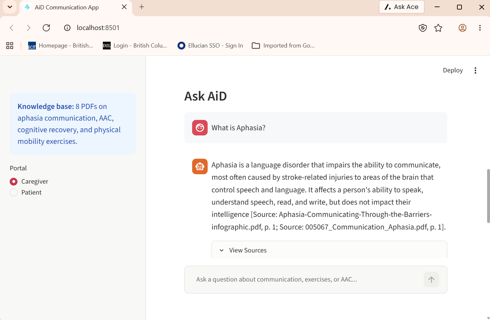
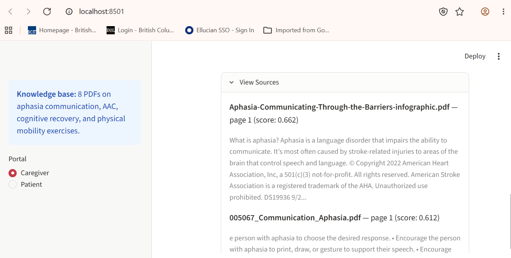

Question 2 on caregiver portal: 
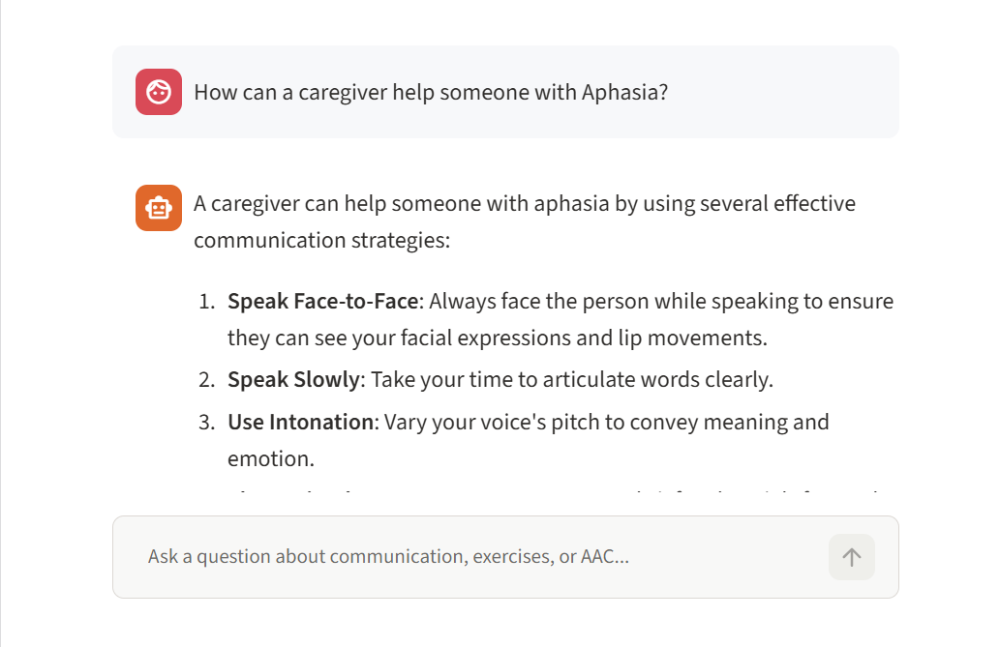
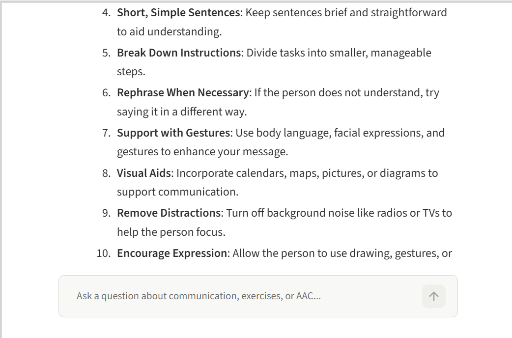
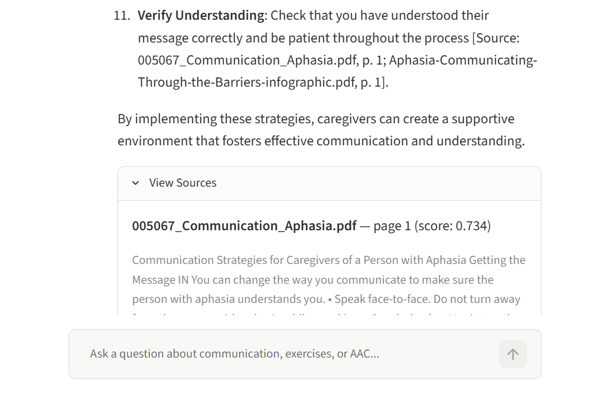

Question 3 on caregiver portal:
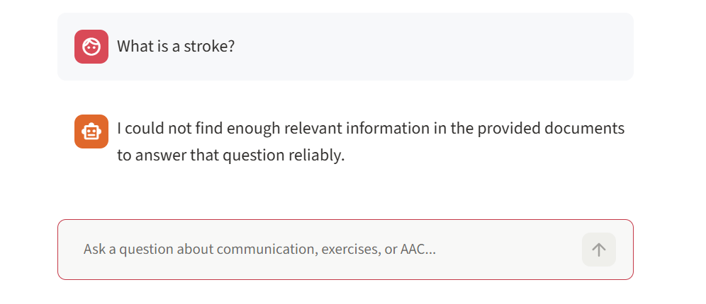
Question 4 on caregiver portal "Paraphrased Question":
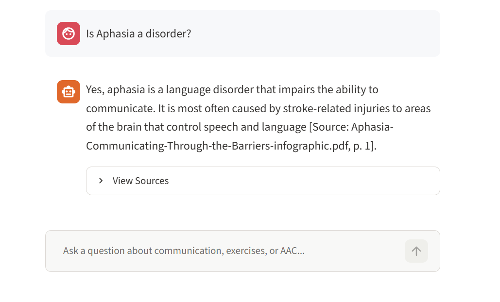
Question 5 on patient portal "Paraphrased Question"
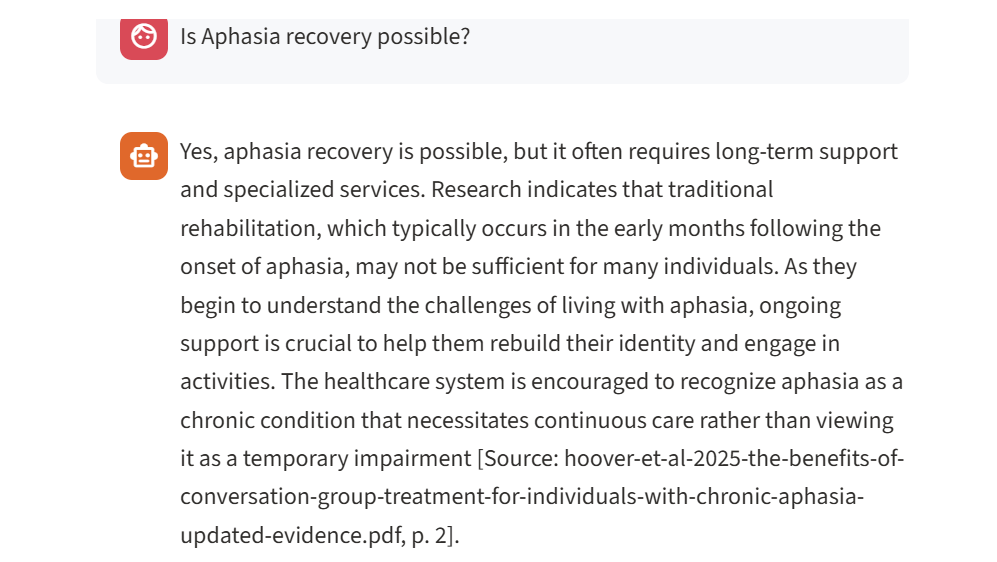
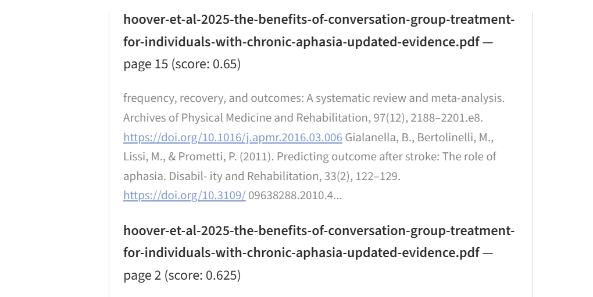
Question 6 on patient portal "Mispelled Question"
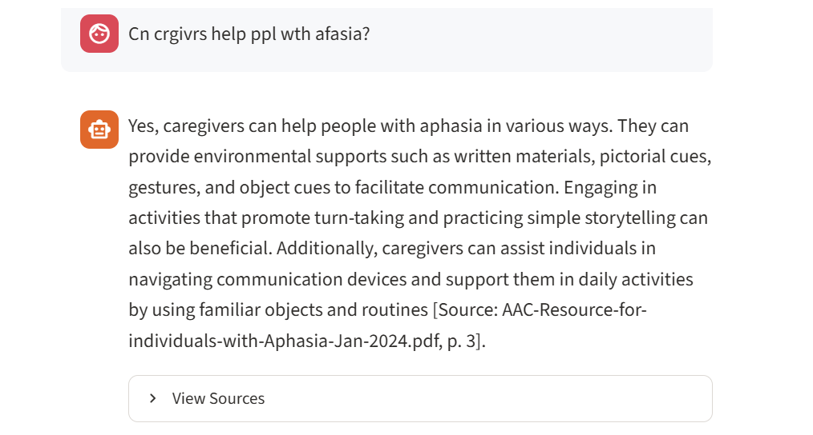
Question 7 on patient portal (From two different sources):
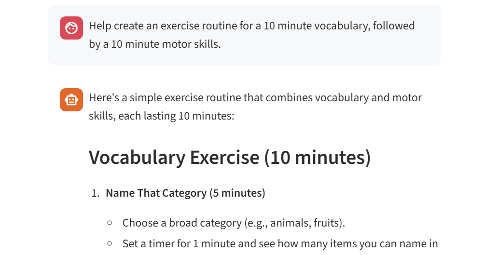
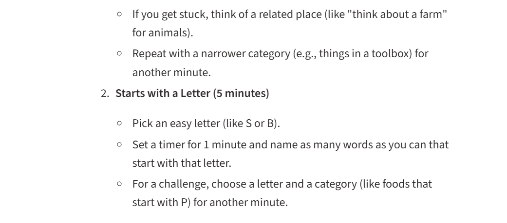
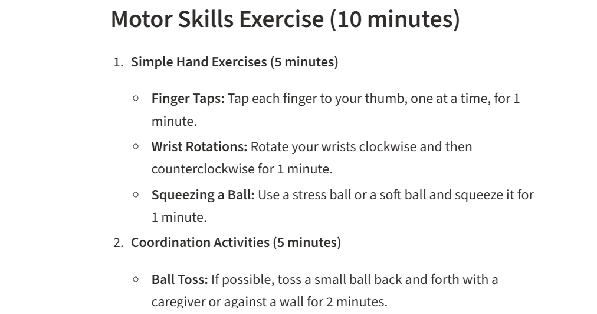
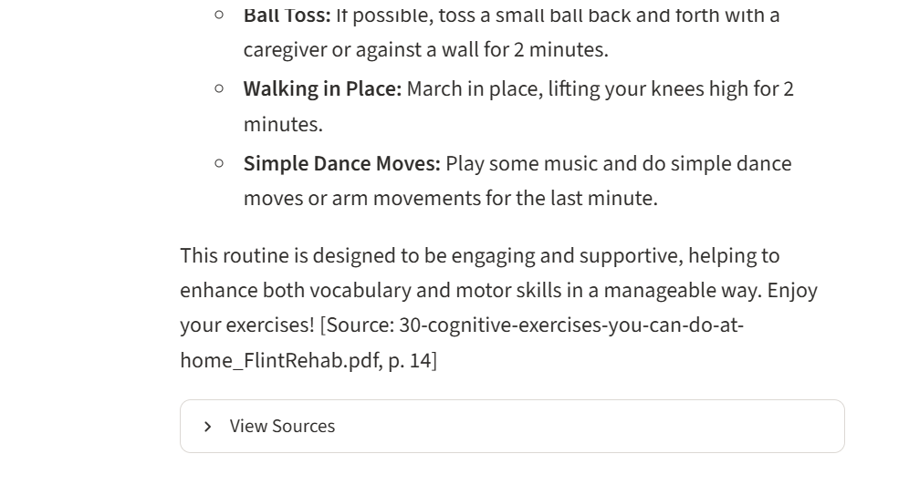
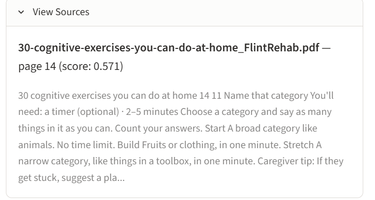
Only quoted coordination side for spacing and didn't provide the coordination activities section.

Question 8 on caregiver portal:
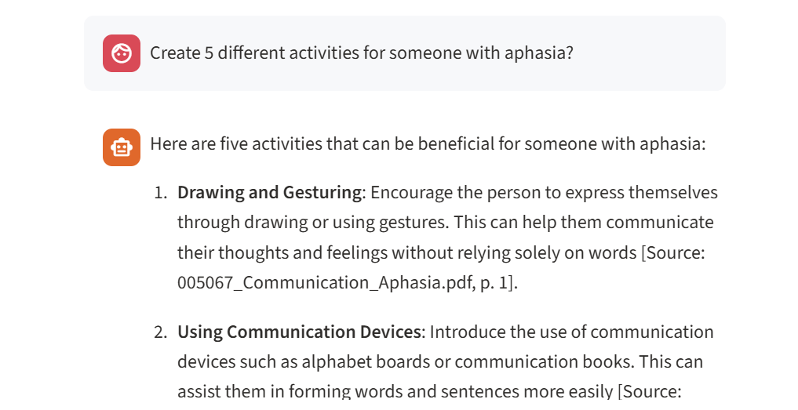
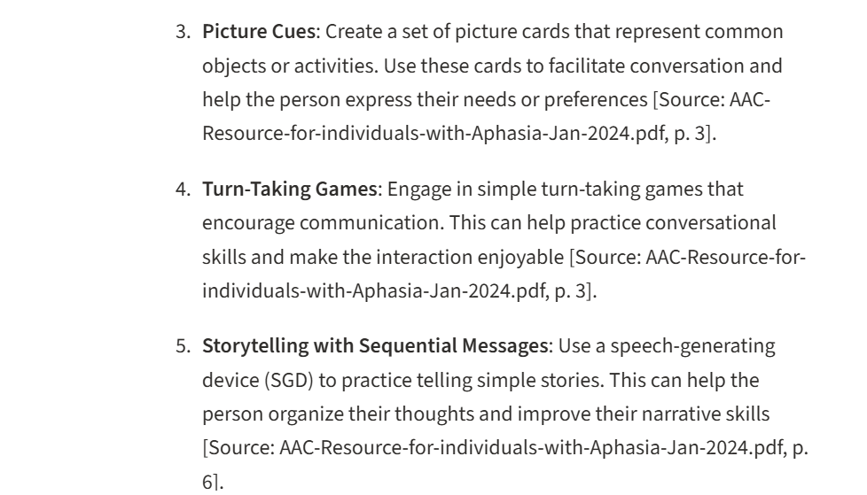
This time it quoted from same document in different pages and sections correctly.

Question 9 on patient portal:
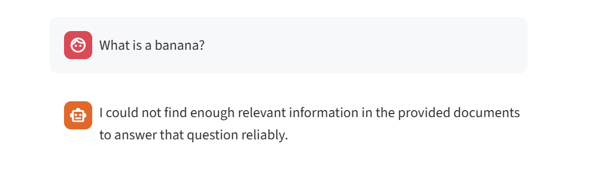
Question 10 on caregiver portal:
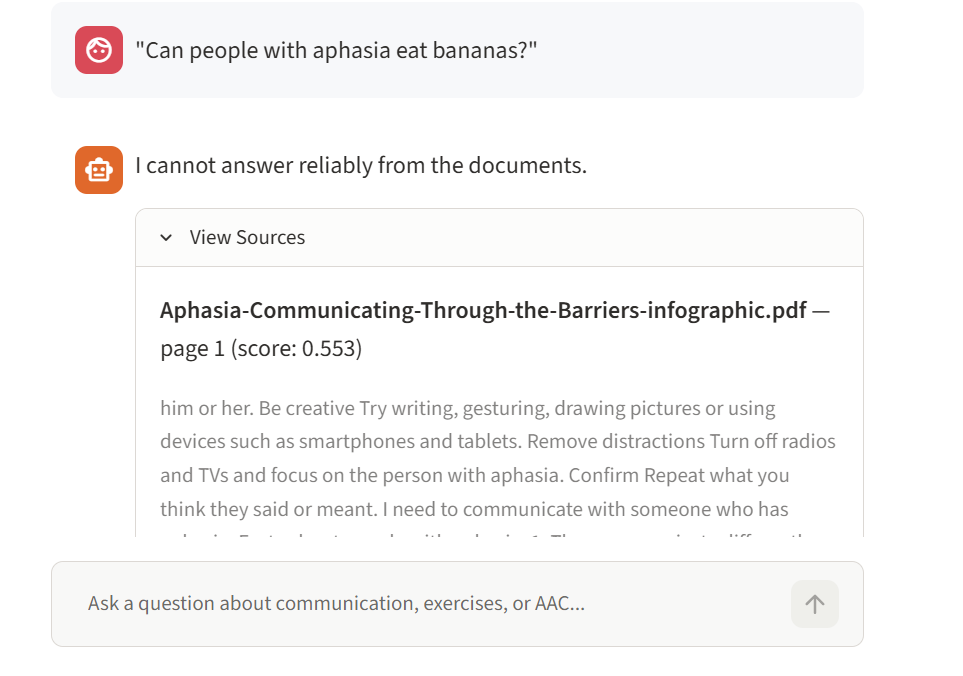

## Error Handling
Missing API key, failed PDF extraction, empty retrieval, and generation errors are caught and shown as user-friendly messages instead of crashes.
